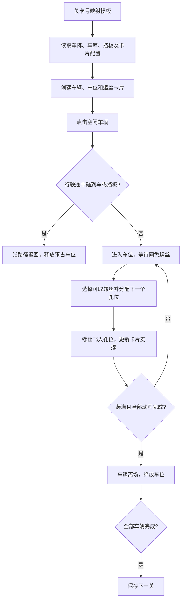

# 游戏实现逻辑：车辆、螺丝、道具、挡板和车库

基于本工程当前 `src/game/main.js`、`src/shared/utils.js` 和解码配置核对。重点是经典挪车玩法；海洋、冰雪等有派生车辆脚本，不把这些变体全部当作完全相同的行为。这里的“车库”指棋盘上带箭头和剩余数量、会继续出车的建筑，不是主页的装饰房间。

## 整体如何串起来

这是 Laya 负责渲染与基础能力、FairyGUI 负责界面和上方卡片、业务脚本负责规则的组合。上方卡片使用二维物理，下方车辆和螺丝飞行动画使用三维对象。

`GameController.Init`（`main.js:41588` 附近）先取关卡模板，再读取 `map_3d`、`map_2d` 等。车阵和障碍布局来自预设，螺丝着色、部分选择与刷新有动态规则。网页的高关卡号按模板数取余；显示和存档仍保存完整关卡号。

## 1. 碰撞检测是引擎功能，还是代码逻辑？

两者都有，但负责不同部分。

| 部分 | 实际实现 |
| --- | --- |
| 上方卡片的下落、转动、卡片之间的物理碰撞 | Laya 二维物理：`RigidBody`、`PolygonCollider`、`RevoluteJoint` |
| 什么时候让卡片开始转动、掉落 | 游戏代码根据剩余螺丝数量切换静态/动态刚体 |
| 下方汽车互相阻挡、撞移动挡板 | 主要是游戏自己的平面几何检测和状态切换 |
| 点击选中车辆 | 引擎把屏幕点击转成射线；业务代码在棋盘平面上判断点落在哪辆车的矩形内 |
| 螺丝被上层卡片遮住 | 层级、可见性及多边形与圆形的相交判断 |

卡片有多个螺丝时通常保持静态；只剩一个时转为动态刚体，用最后一个螺丝的旋转关节挂住；零个时失去固定点而掉落。刚体的碰撞分类/遮罩按卡片层设置，重力比例为 1.3。

代码：`AddCollider.initGraph/initNail`（`main.js:34887`）、`Graph.refreshPhy/initRig`（`41242`、`41312`）、`PhyTool`（`21575`）。

## 2. 磁铁吸引的逻辑

磁铁不是按距离施加真实物理吸力，而是自动执行螺丝挑选、装车和动画：

1. 道具动画进行中，拒绝重复启动。
2. 从车位中找第一辆处于等待状态、尚未装满的车。没有目标就提示“暂无可用车辆”。
3. 播放磁铁模型特效。
4. 优先调用普通 `getScrew(车色)`，找可见、未被遮住、未被使用的同色螺丝。
5. 普通查找没有结果时调用 `getScrewForce`，可以跨越普通的可见/遮挡条件找同色螺丝，或者拿一个尚未确定颜色的螺丝，将其颜色设为目标车的颜色并绑定。不会任意把已经着色的异色螺丝全部改色。
6. 调用车辆 `addScrew`，每轮间隔约 100 ms，直到目标车装满、目标车不再等待或无可用螺丝。
7. 特效至少持续约 1 秒，回收特效对象并回到正常状态。

当前按钮对应单车磁铁；源码另有 `PropMagnetAll`，不等于当前按钮的实际效果。网页已把磁铁次数固定为 1，不扣次数，不经过该按钮的广告领取流程。

代码：`GamePropMagnet`（`main.js:37764`）、`getScrewForce`（`37183`、`41393`）。

## 3. 刷新如何重置汽车？

刷新主要改颜色，不移动汽车的位置、朝向、车型或孔数，也不重新生成整张地图。

首先检查空闲且没有装螺丝的车中，是否存在至少两辆同色车；否则显示原来的“剩余车辆不足”提示。实际重新分色时还排除已被使用过的车辆。

`doRefresh` 将可刷新的车按孔数分组（4 孔、6 孔、8 孔等），保留每组原有的颜色集合。然后：

- 通过 `CanMove` 把较容易驶出的车排在前面。
- 读取上方当前可取螺丝的颜色优先列表。
- 给能够驶出的车优先分配这个列表中、且本组仍有的颜色。
- 剩余车辆从本组剩余颜色中随机分配。

候选遍历整关的车辆列表，没有按显示状态排除车库中的隐藏车辆；未使用的库存车也可能参与颜色重分配。

因此，同一孔数组内的颜色数量保持不变，螺丝总需求不会凭空增加。播放约 1.5 秒变色动画后应用新颜色，再等待约 0.5 秒结束。`CanMove` 的这个预判只检查车辆，不能保证当时移动挡板恰好不挡路。

源码：`GamePropRefresh`（`main.js:37845`）、`doRefresh`（`38133`）。网页刷新次数同样固定为 1、使用不扣除、无需广告。

## 4. 螺丝怎么匹配汽车孔位？

匹配顺序是“选车 → 选同色螺丝 → 选下一个空孔”，不是让螺丝自由碰撞到任意孔里。

- `moveScrew` 收集所有处于等待状态、还有空孔的车，并按剩余孔数从少到多排序，优先尝试快装满的车。
- 普通螺丝必须未占用、已着色、尚未装车、未销毁、可见且颜色一致；还要通过上层卡片遮挡判断。
- `CarScript.addScrew` 先标记该螺丝正在使用，加载三维螺丝实例后再次核对颜色。
- 孔位直接取 `hp_Screw.getChildAt(this.screws.length)`，按预设节点顺序填入，不做最近孔位搜索。
- 二维螺丝位置转换到三维相机坐标，播放拔出、飞行、旋入动画。飞行时原二维螺丝被移除，卡片支撑随之更新。
- `try2Out` 既检查数量装满，也检查每个螺丝都完成动画，满足后车辆才离场。

还有一层 `data_2d`/`bindNail` 绑定用于生成和分配颜色需求；它与最终装入哪辆同色车、哪个孔位的实时选择不是同一层数据。

代码：`moveScrew`（`main.js:38008`）、`addScrew/try2Out`（`36086`）、螺丝状态机（`35650` 附近）、`bindNail`（`38103`）。

## 5. 汽车之间、汽车和挡板怎么碰撞？

汽车先按预设朝向向棋盘边缘驶出，再沿外侧路径驶向预占的车位。移动使用路径插值和状态机，不是给刚体施加发动机力。

`CalculateWorldCorners` 从车型网格包围盒计算世界坐标下的车身矩形，并在棋盘 X/Z 平面使用它。普通碰撞矩形经过缩放；触摸选择还另有稍放大的矩形。

行驶状态 `Park` 的每帧后更新中：

1. 更新本车的矩形。
2. 对其他活跃车辆执行 `IsCollision`。
3. 无车辆碰撞时，再对 `list_props` 中的移动挡板做同样检查。
4. 碰到目标后进入 `Back`，播放碰撞特效/声音，沿原路径或后退动画回到起点，释放预占车位。

`IsCollision` 实际使用中心点/车身顶点是否在对方多边形内的简化检测。它不是完整的三维刚体接触求解。另有 `CanMove` 预判：从车头左右及中间向前延伸三条线，检查是否穿过其他车的矩形。预判与行驶中的即时碰撞是两种用途。

碰撞处理还对已经离开棋盘、靠近外圈道路、正在后退等情况设置了过滤，避免外圈离场过程反复触发退回。

源码：`PhyTool.CanMove/IsCollision`（`main.js:21597`、`21706`）、`CarScript.onLateUpdatePark`（`36178`）、`collisionWithCar/Prop`（`35859`、`35885`）。

## 6. 挡板什么时候出现，怎么运行？

由地图配置决定，不是玩到某个时间临时生成，也不是每隔固定关数出现。

`config/decoded/drama_core.json` 的经典模板 `map_3d` 对应 `config/decoded/toolBoxData1.json` 的 `ToolBox编号`；其中的 `obstacleDataArr` 记录移动挡板的位置、轨道朝向及尺寸。按当前配置，经典模板中最早有挡板的是第 15 关（`map_3d=33`，两个挡板）。高关卡循环后按所选模板继续出现。

创建时加载 `Prop_Cementpile`，将配置平面位置转换成三维坐标；名字包含“横”就旋转轨道方向。轨道长度由配置的宽高计算。`Prop_Cementpile.onUpdate` 按帧时间推进滑块，沿轨道局部 Z 轴在两端之间往返，抵达端点后反向；`onLateUpdate` 更新滑块的碰撞矩形。

这里的实际速度公式为 `0.008 × delta毫秒 × 0.2`，约 1.6 世界单位/秒。配置里虽然有 `time`、`baffle` 字段，但这段三维挡板创建/移动代码没有使用它们来控制移动周期，不能只改 `time` 就预期游戏速度改变。

代码：`generateAllObstacle`（`main.js:22644`）、`initCars` 创建障碍（`37970` 附近）、`Prop_Cementpile`（`21957`）、`Utils.Script.Prop.updatePosRange`（`src/shared/utils.js:2123`）。

## 7. 车库怎么实现？

车库是一组预设车辆的隐藏队列，不是无限生车器。数据来自同一地图配置中的 `boxHoleDataArr`，包含位置、方向以及 `toolBoxes` 内的车辆列表。按当前经典配置，最早带车库的是第 17 关（`map_3d=30`，两个车库）。

游戏创建这些车后，将对应车关联到 `CarParkRoom`：

1. 第一辆放到车库出口，车身方向与车库一致。
2. 剩余车辆设为不活跃并保存在车库数组中；数字显示尚未放出的数量，不包含已经摆在出口的那辆。
3. 从该车库驶出的车到达停车位，进入 `onEnterWait` 时调用 `room.updateCars()`，触发补下一辆。
4. 选择下一辆时优先挑与当前上层螺丝颜色匹配的库存车；没有匹配才取队列第一辆，因此不一定严格按原配置顺序出车。
5. 车库播放缩放动画，选中车辆激活，再用约 200 ms 的位移动画送到出口；更新车辆碰撞矩形和剩余数字。
6. 数组为空后不再补车。隐藏车辆不是后来随机创建的，容量与颜色已参与整关数据。

源码：`generateAllHoleBox`（`main.js:22388`）、`initCars` 关联车辆（`37954`）、`CarParkRoom.init/updateCars/aniOutCar`（`21833`）、`CarScript.onEnterWait`（`36211`）。

## 阅读顺序

先看 `GameController.Init` → 地图脚本 `initCars/onClickCar/moveScrew` → `CarScript` 状态机 → `PhyTool` → `Graph/Nail` 与 `AddCollider`。原文件保留反编译变量名，检索上面这些可读方法名通常比从头阅读更快。本文行号以本次核对版本为准。
