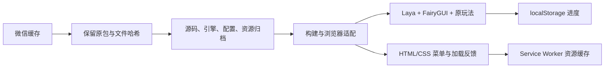

# 学习报告：从微信缓存到可离线玩的网页

整理日期：2026-11-25。代码基准：`20261125.5 / 4401c38`，固定标签 `milestone-20261125.5`。本文总结已经得到证据的认识和仍未验证的边界；操作步骤、完整玩法细节分别见 [README](../README.md) 中的专题入口。

## 1. 最终交付及边界

工程从本机微信缓存出发，整理了发布 JavaScript、Laya 运行库、配置和访问过的资源，形成基础网页版、手机/PWA 版和静态检查过的微信工程。手机入口可按需或完整下载，提供选关、存档迁移、重启与诊断；已有七个车位开放，磁铁和刷新可重复使用。

这次恢复的是**客户端运行工程**，不是原作者的编辑器工程。缺失的 TypeScript、编辑器场景工程、服务端以及未访问资源，不能凭缓存自动恢复。当前网页 393 套模板来自五种玩法；515 条全玩法配置不代表 515 关都能运行。猫咪、打巨龙和部分房间仍缺资源。

用户已确认手机画面、明显卡顿和停绘问题改善；最新资源修复通过了本地 Chrome/WebKit 故障注入测试，原手机空引用现场仍未复测。把“实现了”“本地测过”“真机确认”分别记录，才不会把部分成功写成全面验收。

## 2. 技术路线为什么能成立

浏览器重做的重点是运行环境，而不是重写游戏：恢复脚本依赖顺序，替换微信专属接口和资源根地址，展开压缩数据，再给原引擎套页面入口。这样能复用模型、二维组件、物理、关卡和动画，降低规则偏离；代价是原框架的隐含假设也被带进网页，需要逐项验证。

纯前端不等于无 HTTP。页面仍需静态站点提供脚本、WASM 和资源，已测试玩法不需要业务后端；完整离线则依赖事先缓存。代码托管、静态发布、浏览器存档是三件事：推送代码不代表部署完成，部署完成不代表旧缓存更新，Git 标签也不会备份手机进度。

## 3. 调试中改变认识的证据

| 起初的判断/现象 | 后来获得的证据 | 保留下来的做法 |
| --- | --- | --- |
| 手机漏车，可能是 WebGL 兼容 | 强制 WebGL 1 更慢；两个不同车辆共用对象 ID 和坐标 | 修对象池借出登记，先核实实例身份与生命周期 |
| 息屏后车不动 | 不息屏也复现；页面仍响应，绘制关闭且恢复计数持续增加 | 捕获停绘来源栈，移除网页不适用的平台检查 |
| 帧率低，可能机器性能不足 | 普通来源运行到特定帧数后主线程耗时上升，再关闭绘制 | 记录整帧耗时与时间线；不要只降画质或反复恢复开关 |
| 资源只有几十 MB，不该下载半小时 | 近两千小请求重复等待，首屏又阻塞在大脚本前 | 合并传输、首屏先绘制，按阶段显示进度 |
| 加版本参数应该拿到新版 | Service Worker 去除查询参数，仍返回完整旧版 | 明确离线版本切换，并留独立恢复入口 |
| 空引用一定是资源缺失 | FairyGUI 已销毁对象也会触发同类报错；截图缺完整调用栈 | 下载校验与生命周期保护分开处理，保留诊断 |

完整过程和失败尝试见 [故障与踩坑](TROUBLESHOOTING.md)。本地增加响应延迟的下载对照实验能说明请求数成本，不能冒充真实手机测速；桌面 WebKit 能验证部分 Safari 行为，不能替代 iPhone 硬件测试。

## 4. 游戏规则比画面更有状态

游戏没有只凭颜色就成立的单一步骤。车辆经历 Idle、驶入、Wait、离场或后退；螺丝经历未定色、已定色、预约、飞行、安装完成；板块随支点减少而转动或掉落。画面尚有空孔时，代码可能已经为它预约了螺丝。

普通装车优先补剩余孔少的等待车辆，磁铁则选车位数组里的首个可用目标；两者不能用同一优先级解释。刷新重排同孔数车辆的颜色，不改变车阵。车库是有限预设库存，出车顺序参考可见螺丝颜色；数字是库存计算结果配合数字素材显示。

开局蓝红多来自配色权重，而非固定种子；随机选择仍受当前车辆需求、板块层次约束。固定地图与动态配色可以同时存在。结算“超过多少用户”只是本地按耗时区间随机显示，不能从界面文案反推真实统计系统。细节与源码检索入口见 [玩法实现](GAMEPLAY_LOGIC.md)。

## 5. 资源系统需要区分四种状态

**下载、读取缓存、解析、创建场景**必须分开。9 MB 运行脚本到达后仍要本关资源；文件都在本机，也仍需执行代码、解析模型、上传纹理。进度条的阶段比一个模糊百分比更有价值。

按需加载与离线缓存并不冲突：第一次需要才下载，随后复用。完整包解决一次保存大量小资源的传输成本，但不是每次启动都解压；当前打包数据拆回原 URL 后逐文件缓存。缓存是否匹配由内容指纹决定，页面文案更新无需强迫引擎文件重新下载。

恢复机制要独立于可能损坏的部分：加载提示不依赖大引擎，恢复页不依赖游戏初始化；存档独立于资源缓存。可恢复的缺资源自动补齐并反馈，重试耗尽则明确失败，不用“正在更新”无限掩盖错误。

## 6. 后续修改如何减少回归

1. **从行为入口改。** 先定位状态机、配置和调用点，再选择修改源码或构建适配；无需先全量重命名混淆变量。
2. **只设一个当前事实入口。** README 说明版本与导航，专题说明当前机制，故障文档保留过程，reports 保留带范围的证据，避免每个版本复制一套教程。
3. **保留可还原基线。** 从里程碑开分支试验；源文件变更后重新构建，不手改产物。玩法/存档结构变化前额外导出进度。
4. **针对风险验证。** 关卡边界验证映射，道具验证目标与数量，池化验证实例独立，缓存验证坏文件和旧版升级，长时间运行验证停绘。静态检查、截图、用户真机反馈各有用途。
5. **把未知留在文档里。** 全部模板未逐关验收，第 100 关历史漏车未单独完整复测，最新空引用原现场缺调用栈，缺失玩法没有运行结论。未来若改这些区域，再补对应验证。

本次最值得复用的方法是：保留原始证据，先分清资源、对象、状态与运行环境，再用可重复的观察缩小原因。重启能恢复只是线索；只有找到被重置的异常状态，才能判断修复是否真正覆盖问题。
